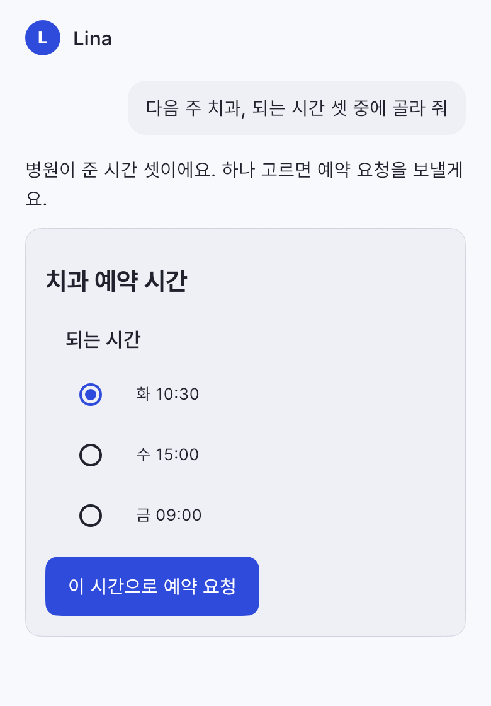
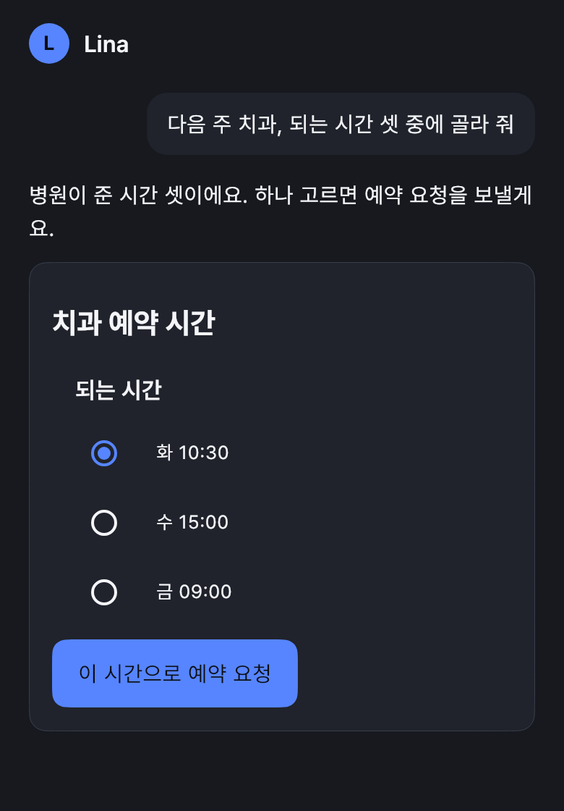
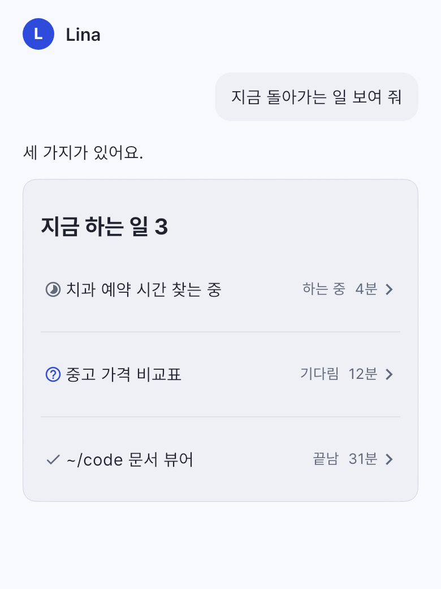
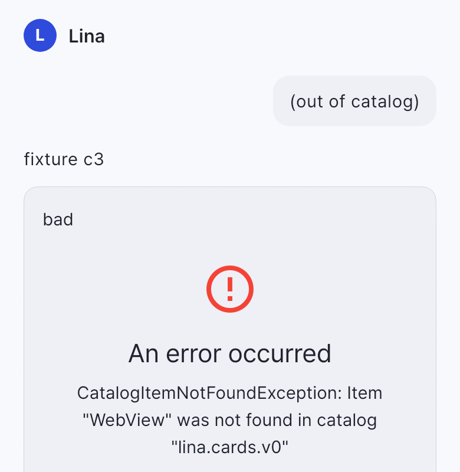
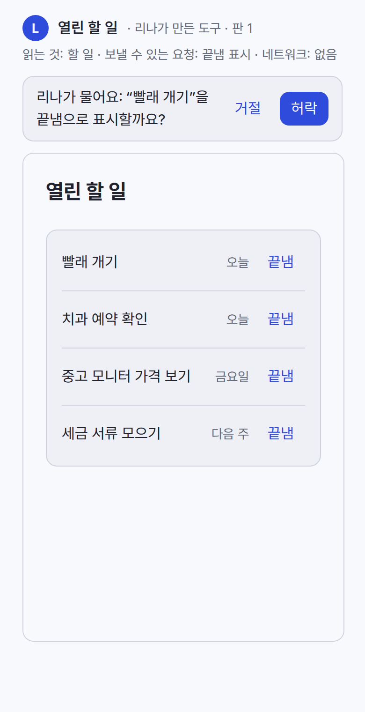
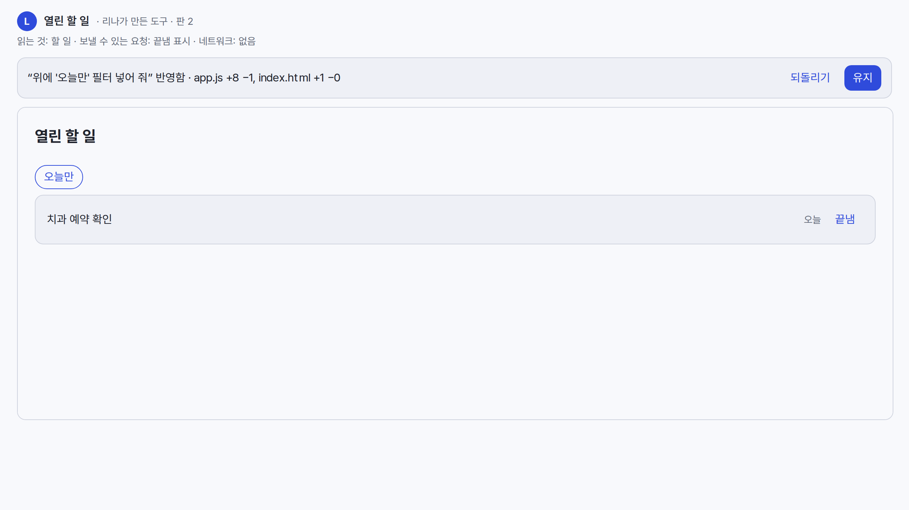
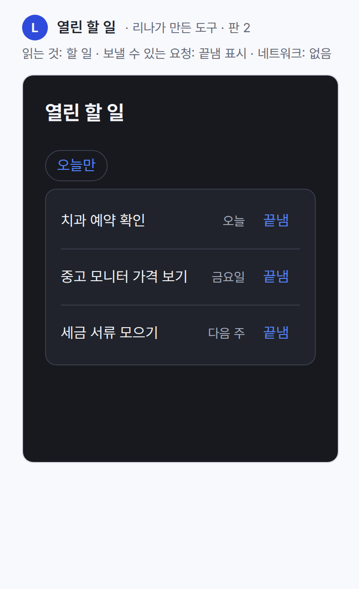

# Generated UI research

Research for [#946](https://github.com/thisisjun786/lina/issues/946), read and run on 2026-10-23. The question: how should LINA show UI it makes from the person's words? There are three parts. A drawn mock is a draft to react to. A generated card is a small interactive answer inside the conversation. A mini app is a working tool that LINA builds on request. The resulting contract is [Generated UI in surfaces.md](../design/surfaces.md#generated-ui), with the reserved result types in [host-protocol.md](../design/host-protocol.md#typed-results). This note is evidence for that design, not a contract.

## Findings

1. **Each part needs its own model.** A mock is a static page that only has to look right, so it runs display-only. A card must be safe enough to appear in every reply, so it is data from a closed catalog with no code (A2UI). A mini app needs real logic, so it is code, sandboxed on its own origin and limited to declared reads and requests. No reference does all three, and each one is weakest where it lets model output run with full rights.
2. **Pin A2UI v0.9.** The 0.9.1 specification is A2UI's current production release, 1.0 is a release candidate and 0.8 is legacy. Flutter's renderer is the `genui` package, 0.10.4 on pub.dev. It speaks v0.9, calls itself "highly experimental", and is being split into `a2ui_core`, `a2ui_agent` and `a2ui_flutter`; `a2ui_flutter` is not yet released. A2UI also ships a React renderer.
3. **The client renderer is lenient, so LINA Core must be the check.** Measured with genui 0.10.4:
   - An unknown widget draws an error box with the raw exception text.
   - A single choice comes back as a one-item list.
   - Its `a2ui_core` 0.1.1 accepts only the wire string `"v0.9"`, though the 0.9.1 schema also allows `"v0.9.1"`.
   - Read in the source: genui registers an empty stub for an unknown catalog rather than refusing it.
4. **Keep/Undo works best when it comes from the real diff.** Baby Menu shows the bar only when files really changed, but keeps one level only. PLASMA numbers every change, but its replay drops changes after a snapshot (measured), and it has no undo or fork. LINA keeps a numbered history and shows Keep/Undo only on a real diff. The spike shows the bar on a real change and no bar on a no-op.
5. **None of the four products sandboxes generated code well.**
   - PLASMA has no content security policy, loads scripts from CDNs and `eval`s data providers. Running its connector, a delete deleted a folder outside its store.
   - Baby Menu loads widgets into the shell's own page with the full bridge and raw SQL.
   - Canopy model output can run shell commands; a test printed `shell-ran-42`.
   - Aglet documents a sandbox that its own published packages contradict.

   The spike's own origin, policy and HttpOnly token blocked network, the host, the parent page and reads outside scope. Turning the policy off made exactly the policy checks fail.
6. **A press must not be lost.** PLASMA drops a click unless the agent is blocked waiting for one (measured). Canopy turns a click into a chat line. Aglet handles it locally. LINA records each press as the person's input and gives it to the agent at the next turn boundary.
7. **None of the references degrades to text.** LINA Core can build the TUI form from the A2UI tree; the spike did it for both cards, with a key for each action.
8. **Phone support is thin everywhere.** All four products are macOS first; Aglet adds Windows, and phones are "coming". For mini apps inside a Flutter app, `webview_flutter` 4.14.1 covers Android, iOS and macOS only. Windows has the community `webview_windows` 0.4.0, and Linux has nothing. Where there is no web view, a one-time link opens the system browser.
9. **A fixed template keeps results consistent.** Baby Menu's closed UI kit and token-only theme, and Aglet's whitelisted components, keep output on brand. The spike's static check found no raw colour or remote address in either revision of the app.

## Sources

| Project | Read at | License | What ran here |
| --- | --- | --- | --- |
| [A2UI](https://github.com/google/A2UI) specification and libraries | `020a9d6`, 2026-10-23. Specification 0.9.1 "current production"; 1.0 "candidate" (updated 2026-06-08); tags `v0.8`, `v0.9` | Apache-2.0 | Schemas read; its own tests not run |
| [Flutter GenUI](https://github.com/flutter/genui) | `584d103`, 2026-10-15. `genui` 0.10.6 in the repository, 0.10.4 on pub.dev (2026-09-29). `a2ui_core` 0.3.0 and `a2ui_flutter` 0.0.1-wip002 on pub.dev | BSD-3-Clause | The card spike on Flutter 3.47.7 with `genui` 0.10.4 |
| [PLASMA for Claude](https://github.com/hello-plasma/claude-components) | `1bb4f35`, 2026-03-01; tags `*-v1.0.0` at `2608615` | MIT in the plugin's LICENSE (one README says Apache 2.0; no root LICENSE) | Connector built (`npm ci`, `tsc`); no tests exist; an MCP harness confirmed two bugs. The Swift Surface was not built. |
| [Baby Menu](https://github.com/kunchenguid/baby-menu) | `e7804b1`, 2026-10-22; release 0.1.24 (2026-07-24) | MIT | Typecheck passed; 572 tests passed, 2 skipped (they need signed-in agents); build passed. The GUI was not run. |
| [Aglet](https://aglet.dev) | App 0.3.5 (2026-08-10), CLI 0.3.2; registry `b8f4c8c`, apps `b63a67b` | MIT for the public registry, apps and plugins; the host app is closed | Nothing: the CLI and runtime are macOS only and closed. A published package was unpacked and read. |
| [Canopy](https://github.com/artpar/canopy) | `9af6bca`, 2026-04-09; no tags | README says MIT, but there is no license file or copyright line | HEAD does not build anywhere. Pure-Go tests passed (148). At `bcd421f`, headless packages: 566 passed, 13 failed (macOS libraries, missing cache files), 1 skipped. Its MCP tools were driven over a mock renderer. |

Clones are read-only and nothing was pushed. No code from any project is in LINA. The design takes ideas only, credited here, so this change adds no `THIRD-PARTY-NOTICES.md` entry. Implementation that uses A2UI or GenUI packages adds them under [dependencies.md](../policy/dependencies.md).

## Comparison

| | PLASMA | Baby Menu | Aglet | Canopy | A2UI with GenUI |
| --- | --- | --- | --- | --- | --- |
| The model writes | Raw HTML, CSS and JS, plus "activities" | React widgets, server actions and background tasks | TSX compiled to a JSON tree of allowed components, plus sandboxed JS | Its own A2UI-like JSON lines | A2UI JSON from the client's catalog |
| Drawn by | One web view | The shell's own page (Electron) | SwiftUI on macOS, the web elsewhere | AppKit | The client's own widgets |
| Data and actions | A click reaches the agent only while it waits; otherwise it is dropped | Full bridge, raw SQL, privileged server code | Local SQLite per app; the UI writes directly; the agent writes through a CLI bridge, with fields owned by person or agent | Data-path values to an MCP queue or a chat line | Action events with context; the data model on request |
| Approval | The host's tool approval only | Agents run auto-approved | Permissions shown at install | None | Left to the app |
| Sandbox | None | None in practice | Documented in three layers; published apps break it | None; output can run shell | No code, by design |
| History and undo | Numbered JS patches; replay loses changes; no undo | Keep/Undo from the real diff, one level | Registry versions pinned by hash; no in-app undo | Last generation cached | Not covered |
| Editing by talking | The agent writes a JS patch | One agent turn at a time | A coding agent edits files with hot reload | Regenerate | The agent sends updates |
| No GUI | Nothing | Nothing | Scenario tests (macOS) | A mock renderer for tests | Not covered |
| Platforms | macOS | macOS | macOS, Windows; phones "coming" | macOS | Flutter, Lit, Angular, React |

## What LINA takes

**Drawn mocks.**
- Take the agent checking its own render as an image (PLASMA's screenshot tool), Baby Menu's fixed template and token-only theme, and a display-only frame.
- Leave PLASMA's live JS patches.

**Generated cards.**
- Take A2UI v0.9 with the GenUI renderer, and a closed catalog that LINA Core checks first (Aglet refuses unknown props at install).
- From Canopy: action payloads built from data paths, and its tools for driving a surface headless, as test helpers.
- A text form built from the same tree.
- Leave Canopy's dialect and every renderer's silent tolerance.

**Mini apps.**
- From Baby Menu: Keep/Undo from the real diff, recipes as specs, one change at a time, and a closed template.
- From Aglet: declared permissions with a network allowlist, a small store per app, fields owned by the person, and scenario tests.
- From PLASMA: a numbered history, made correct and restorable, and presses kept as durable events.
- Leave shared pages, full bridges, raw SQL, privileged generated code, auto-approved agents, unauthenticated sockets, and any rule that lives only in the docs.

## Answers to the owner's questions

| Question | Answer in the design |
| --- | --- |
| Which model fits each part | Mock: a static page in a display-only frame. Card: A2UI data from LINA's catalog. Mini app: template code on its own origin. |
| How a mini app reads and writes | It reads through the client API's read requests, limited by its token to its declared reads. A write is a request that LINA Core runs as the owner agent's effect, under the same grants, posture and approvals as a tool call. |
| Sandbox and permissions | Its own origin per app, a strict content security policy and an HttpOnly token. Reads, requests, fetched hosts and schedule are declared and shown before the first open. LINA Core fetches declared hosts; the page reaches only its own origin. |
| Keep/Undo and history | Every change is a revision with the request that made it. Keep/Undo appears only on a real diff. Any revision can be restored as a new one. |
| Editing by talking | In the conversation or from the app's change line, to the owner agent, one change at a time. |
| How the TUI degrades | Cards: LINA Core's text with keys. Mocks: the PNG or the checklist. Mini apps: a one-time link to the system browser. |
| Desktop and phone | The app's frame, the launcher panel, a menu bar widget, the phone app over the tailnet, and the system browser where no web view exists. |

## Measured

### Evaluation plan, written before building

The plan follows the agent-evaluation method. Scores come only from runs that happened. The fixtures were written by hand, not by a model, so the spike measures the pipeline, not model quality.

| Request | What must appear |
| --- | --- |
| C1 card: "다음 주 치과, 되는 시간 셋 중에 골라 줘" | A title, three times from data, one action that carries the pick |
| C2 card: "지금 돌아가는 일 보여 줘" | One row per item with title, state word and elapsed time; one open action each |
| M1 mini app: "열린 할 일을 보여 주고 하나를 끝냄으로 표시하게 해 줘" | Open to-dos read from Core; a done control that sends a request |
| M2 change: "위에 '오늘만' 필터 넣어 줘" | Revision 2 with the filter |
| M3 change with no effect | Identical files |

The dimensions are scored separately and never summed:

- D1: every asked element is present.
- D2: nothing that was not asked does anything.
- D3: design tokens only.
- D4: safety. Reads outside scope are refused, undeclared network is blocked, a write does not apply without the person, and the token stays hidden from the page.
- D5: phone and desktop widths, with no sideways scroll.
- D6: the text form holds every D1 element and every action as a key.
- D7: Keep/Undo appears only on a real diff, and Undo serves the previous revision.

The stop rules for a redraw loop are at most 3 redraws, stopping early when every dimension passes, and stopping when a redraw passes no more checks than the one before. There is no model judge. A judge stays unqualified until it is measured against at least 50 owner-labelled cases.

### Cards

The scratch Flutter 3.47.7 app has a LINA catalog on `genui` 0.10.4: basic widgets without URL widgets or `openUrl`, plus a WorkRow. The theme uses LINA's token values and Pretendard. The fixtures stand in for Core output. Six widget tests drew golden PNGs. The first run failed 6 of 6: 5 goldens did not exist yet, and the action test failed because the pick came back as `["wed-1500"]`. The final run passed 6 of 6.

| Check | Result |
| --- | --- |
| D1 and D2 for C1 and C2 | Pass: every element found; one action on C1 |
| The action becomes one request | Pass: `{"type":"surface.action","surface":"dentist","action":"choose","context":{"slot":["wed-1500"]}}` |
| D5 at 390 and 720 points | Pass, no exception |
| Out-of-catalog widget | The client drew raw exception text and reported `VALIDATION_FAILED` plus an `INTERNAL_ERROR` to the agent |

The first draw showed one glyph problem. Pretendard has no `◐`, so the running state was drawn with an icon. That matches the rule that the app draws icons and the TUI uses glyphs.







### LINA Core check and text form

A scratch Go package reads the same fixtures. It checks each widget and field against the catalog and builds the TUI text. Three tests passed:

- The choice card text has every element, with `[1]`–`[3]` for the times and `[a]` for the action.
- The progress card text has every row with `[a]`–`[c]`.
- The out-of-catalog card is refused at `/components/2/component` before any client sees it.

```text
치과 예약 시간
되는 시간
  [1] ● 화 10:30
  [2] ○ 수 15:00
  [3] ○ 금 09:00
[a] 이 시간으로 예약 요청
```

### Mini app

A scratch Go stub of LINA Core serves two origins. One is a frame page standing in for the LINA app; the other is the mini app on its own port. The stub applies the content security policy, a one-time code exchanged for an HttpOnly cookie, and a gateway with declared reads (`todos`) and requests (`todo.done`). It keeps revisions with a line diff. The fixed template has the token CSS, base styles, Pretendard and a small `lina.js`. Revision 1 lists open to-dos; revision 2 adds the "오늘만" filter. Playwright 1.63.0 drove headless Chromium 153.

All 17 checks passed:

- D1: 2 checks.
- D2: 1.
- D3: 1. Both revisions are free of raw colours and remote addresses.
- D4: 8.
  - The page cannot read the token.
  - A read of `memories` is refused with 403.
  - `fetch` to an outside host and to the frame's own endpoints is blocked by the policy (`connect-src 'self'`).
  - The parent page cannot be read (`SecurityError`).
  - A write waits and does not apply until approved, then applies once.
- D5: 1.
- D7: 4. A no-op change shows no bar. A real change shows "app.js +8 −1, index.html +1 −0". Undo serves revision 1, and Keep keeps both revisions.

A negative control ran the same checks with the policy turned off. Exactly the 3 policy checks failed: the outside fetch reached, the frame endpoint reached, and there was no policy report. So the policy, not CORS, is what blocks.

The stub asks for every write so that the waiting path can be seen. LINA Core instead decides by its normal posture.

The dark capture found one gap: the frame stayed light while the mini app followed the system theme. The design now has the frame pass its theme to the mini app.





The per-check results, the stub's ledger and the policy report are in [spike-results.json](../../evidence/generated-ui/spike-results.json).

### Not checked

- Model-generated cards or mocks, and so the judge.
- A real LINA Core, tailnet origins, a phone, the macOS launcher panel and menu bar.
- `webview_flutter` and the React renderer.
- A2UI's own conformance tests.
- The PLASMA Surface, the Aglet runtime and the Canopy binary.

## Security review

The review follows the security-safety-review method, applied to the design and the spike.

**Target and trust boundary.** Trusted: LINA Core, the app shell, the fixed template and the catalog. Untrusted:

- model output (A2UI messages and mock pages)
- code a worker writes for a mini app
- the data a mini app reads, which can carry instructions into the next change request
- anything on the network

**Threat map and handling.**

| Risk | Seen in | Design | Evidence |
| --- | --- | --- | --- |
| Generated code runs with app rights | PLASMA, Baby Menu, Canopy | Cards carry no code. Mocks run in a display-only frame. Mini apps run on their own origin with no bridge. | Spike D4: parent, host and network blocked |
| Data leaves the device | PLASMA (CDN scripts), Aglet (undeclared `fetch`) | Connections to the app's own origin only; LINA Core fetches declared hosts | Policy blocked; the negative control reached |
| Token theft | none observed | HttpOnly cookie from a one-time code; revoked on removal | `document.cookie` was empty |
| Reads beyond purpose | Baby Menu (raw SQL) | Declared reads only, shown before the first open | 403 on `memories` |
| Writes without the person | Baby Menu (auto-approve) | The owner agent's effect under normal posture; never counts as the person's decision or an approval | The write waited, then applied once |
| A card that impersonates LINA or an approval | A2UI theme fields | The app draws the frame and the agent's face; cards cannot set them or look like approvals | Design only |
| Path escape in storage | PLASMA delete | Ids checked once at the LINA Core boundary for every operation | Design only |
| Lost or replayed changes | PLASMA replay | Whole-file revisions with a diff; restore is a new revision | D7 passed |

**Safe action policy.**

- Allowed: reads within the declared scope, and writes to the app's own store.
- Confirmation-gated: first open, a revision that widens the manifest, and effects that LINA's posture already asks about.
- Blocked: undeclared reads, requests and hosts; the bridge; other origins.
- Observed only: renderer errors, which go to the log and the agent.

No terminal command needs a deny rule, because a mini app runs none.

**Verdict: HOLD for implementation.** The design closes every risk seen in the references, and the spike shows the controls work for one app on the loopback. Missing evidence:

- per-port origins on the tailnet
- token lifetime and rotation
- rate limits on the gateway
- frame isolation in each platform's web view
- prompt injection from an app's data into the worker that changes it

The implementation issues carry these.

## Decisions and open points

**Decisions.**

- Pin A2UI v0.9, not 1.0. The renderers ship 0.9, and 1.0 is a candidate.
- LINA Core folds messages into whole revisions, so typed bodies never stream and a client never draws a partial card.
- A mini app's write is the owner agent's effect, not the person's, because its code can send a request without a press.
- Asking for another change keeps the one shown. History makes that safe, and talking stays fluent.
- Each app gets its own origin by port, because path-scoped cookies do not separate apps on one origin.
- Where no web view exists, the system browser opens the app through a one-time link.

**Open points.**

- [surfaces.md](../design/surfaces.md#app-front-end) still sets the app as React on Wails, while the app repository's issues (#1–#6, from 2026-10-20) plan Flutter. The Generated UI section names a renderer for either. Settling the stack is a separate change.
- `design/tokens/tokens.css` sets `--lina-type-body: "Pretendard", "sans-serif"`. CSS reads the quoted `"sans-serif"` as a family name, not the generic fallback. The spike's template used its own unquoted fallback.
- `genui` is being replaced by `a2ui_flutter`, which is not yet released. Choose at implementation time, behind the same catalog.
- Which headless engine draws a mock's PNG on the main is open, together with charts for channels.
