# Connection surface renders

These PNGs come from the built `lina tui` binary through a Linux pseudo-terminal.
The fixture peer answers its real client handshake with the repository's welcome
or refusal envelope. The unavailable case uses an absent socket; the failed case
sends malformed JSON. Capture waits for each complete frame before responding or
sending a single `q`, without Enter. There are no sleeps or synthetic UI strings.
Every case checks its exit code and restoration of the original terminal mode.

[Capture metadata](capture.json) records the binary digest, renderer versions,
font digests, terminal dimensions, display environment and observed exit codes.
Each image is the entire 72 × 16 terminal grid (32 × 16 for the narrow example),
with no frame or crop. Every edge is checked against the terminal canvas.

| Dark | Light | High contrast |
| --- | --- | --- |
| 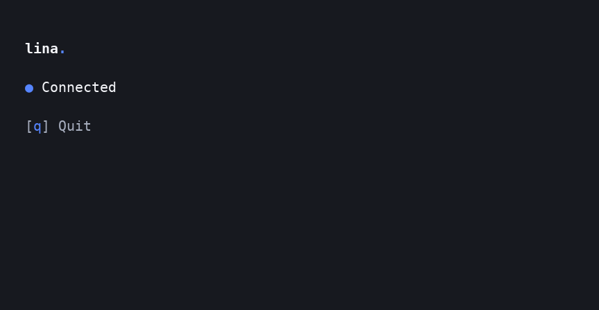 | 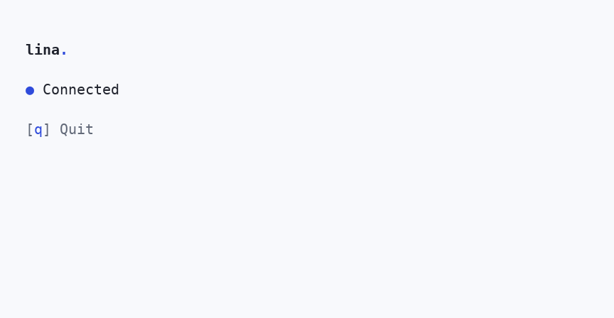 | 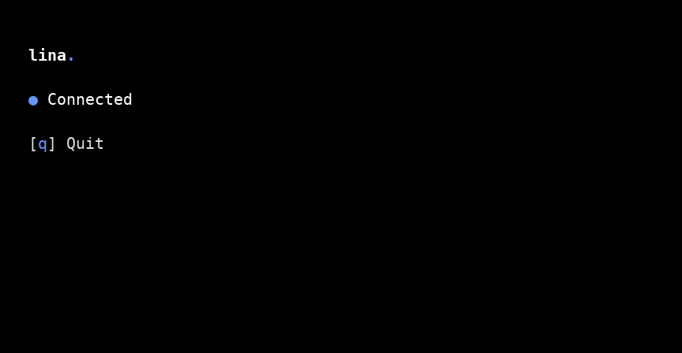 |
| 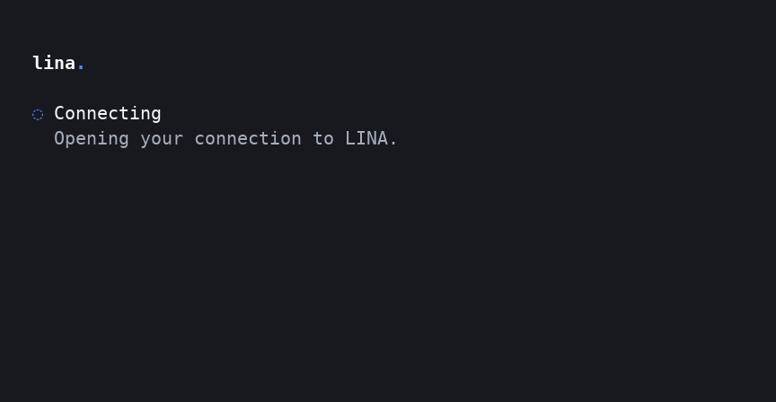 | 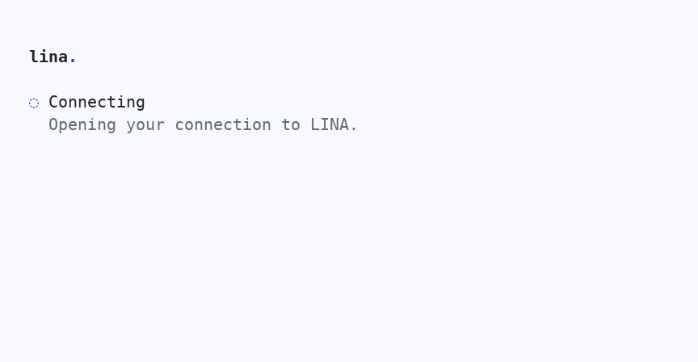 | 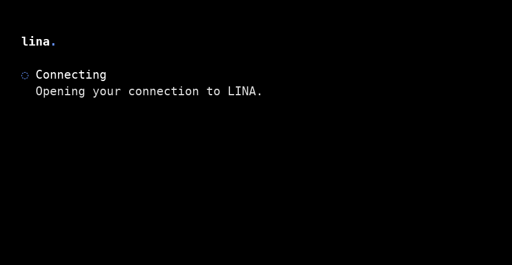 |
| 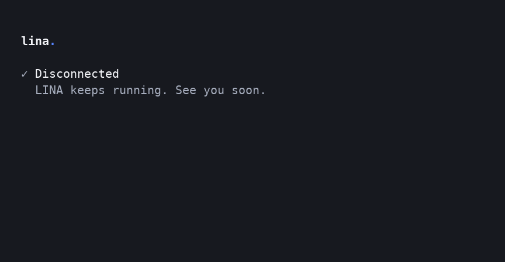 | 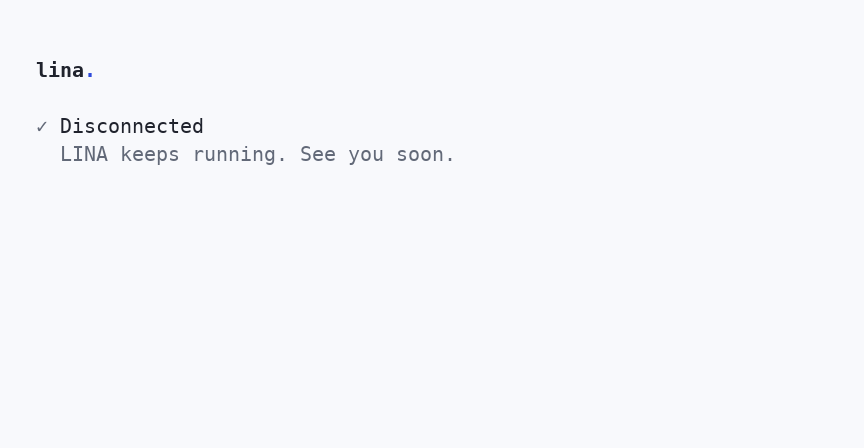 | 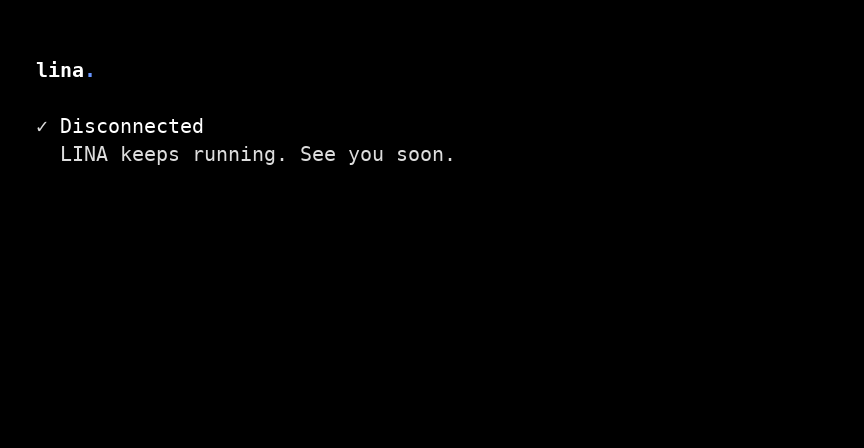 |
| 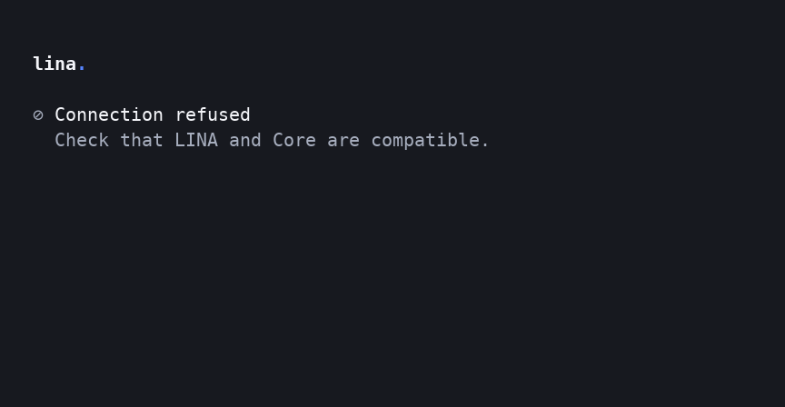 | 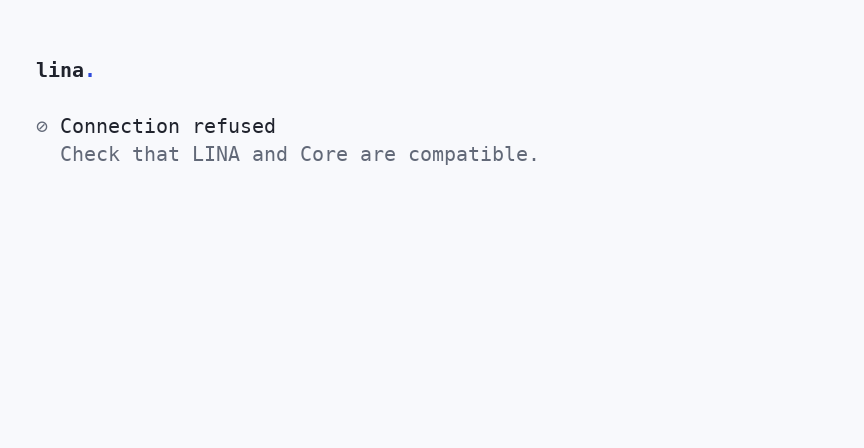 | 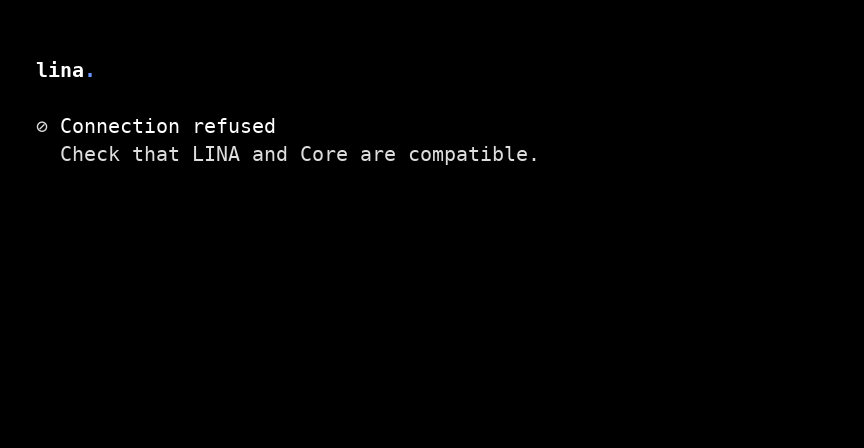 |
| 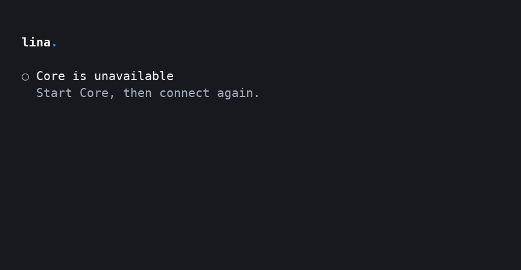 | 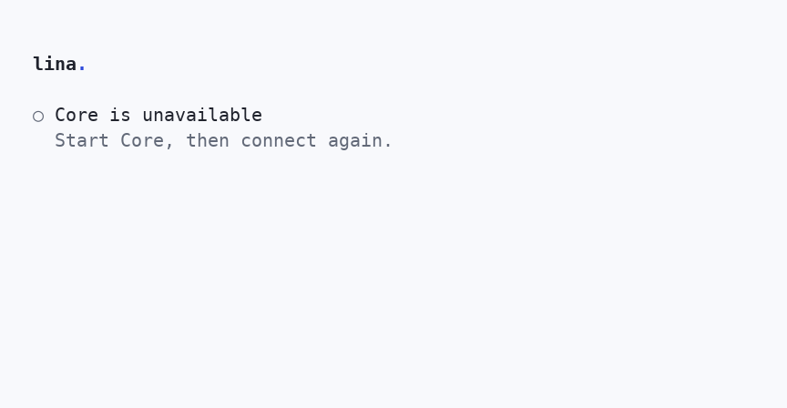 | 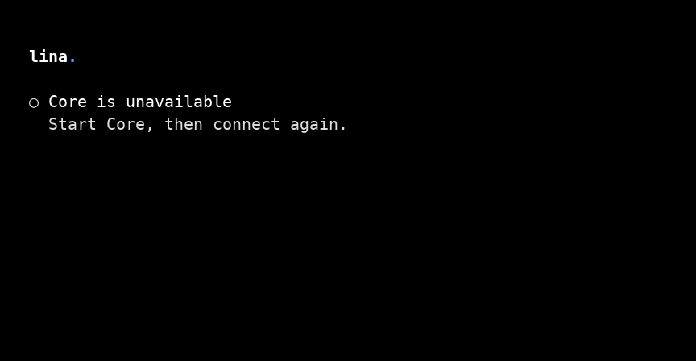 |
| 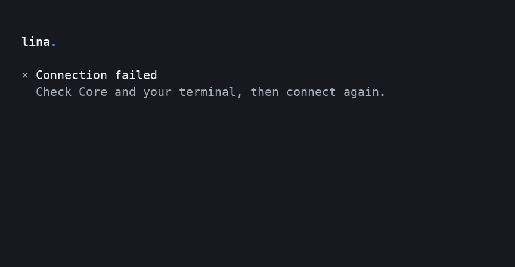 | 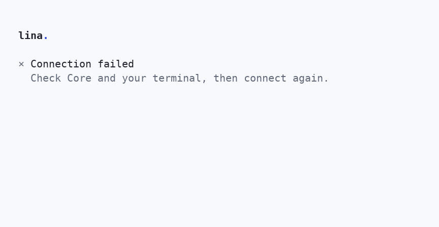 | 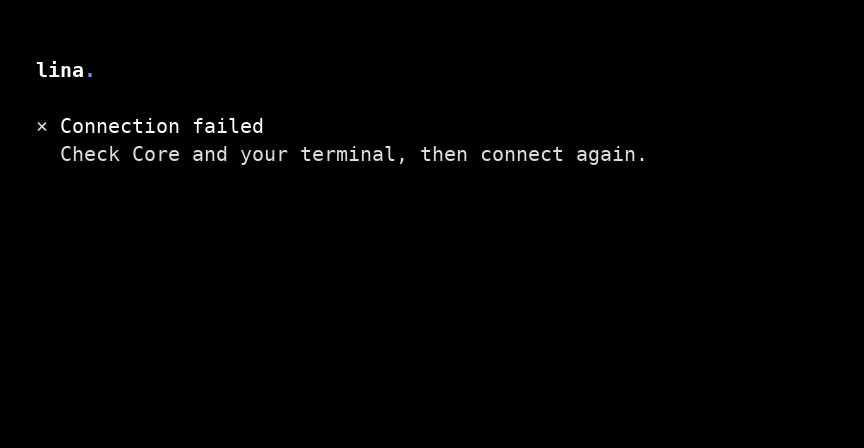 |

[16-colour ASCII](dark-16-72-connected.png) ·
[256-colour ASCII](dark-256-72-connected.png) ·
[NO_COLOR ASCII](dark-none-72-connected.png) ·
[Narrow light ASCII](light-truecolor-32-connected.png)

## Reproduce

Run from the repository root on Linux, with Python 3, Go and the DejaVu Sans Mono
regular and bold fonts. The Python packages are temporary capture tools, not
product dependencies. The script closes its sockets and PTYs and joins its child
processes. The virtual environment and binary are removed afterward.

```sh
brand_tools=$(mktemp -d)
python3 -m venv "$brand_tools/venv"
"$brand_tools/venv/bin/pip" install Pillow==11.3.0 pyte==0.8.2 wcwidth==0.2.13
go build -mod=readonly -buildvcs=false -o "$brand_tools/lina" ./cmd/lina
"$brand_tools/venv/bin/python" internal/tui/ui/testdata/capture_brand.py \
  --binary "$brand_tools/lina" --output evidence/brand
rm -rf "$brand_tools"
```

The capture replays the complete PTY stream through pyte, including cursor-up,
erase and carriage returns. Pillow draws those cells with regular or bold font
according to SGR. Unlike the earlier Freeze capture, it preserves bold and does
not add light-theme bands. Default foreground and background come from the
selected token profile, including its standard ANSI fallback palette. `NO_COLOR`
is the actual compact transcript with no escapes. Both stdout and stderr reach
the captured terminal; connection errors are shown once in the panel, while
redirected stderr and plain output retain their command diagnostics.

The renders were individually inspected after iteration. The wordmark is bold
with a baseline cobalt dot. Active state glyphs and keys use saturated cobalt;
state labels use regular text, and inactive glyphs, brackets and action labels
are secondary. Each state retains its distinct glyph and word in ASCII and
monochrome. One blank row separates groups, the redundant connected description
is gone, and there is no divider or prompt-like footer arrow.

This is deterministic connection-surface evidence. It does not establish live
conversation rendering, the Bubble Tea spike, physical terminal palette colours,
IME behaviour or Omarchy preference discovery.
